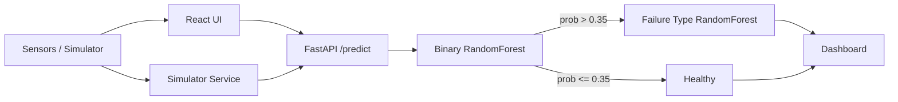

# Predictive Maintenance System


Cloud-native distributed predictive maintenance platform using machine learning. Two-stage ML pipeline for real-time failure detection and failure-type classification with a FastAPI backend and React dashboard.

## Table of Contents
- [Overview](#overview)
- [Features](#features)
- [Architecture](#architecture)
- [Tech Stack](#tech-stack)
- [Project Structure](#project-structure)
- [Getting Started](#getting-started)
- [API Usage](#api-usage)
- [Model Training](#model-training)
- [Deployment](#deployment)
- [Security & Best Practices](#security--best-practices)
- [Contributing](#contributing)
- [License](#license)

## Overview

This project implements a scalable predictive maintenance solution for industrial machines. Sensor telemetry is ingested, processed through a trained two-stage model, and visualized in real-time.

The system is designed for cloud deployment with containerized microservices, CI-ready training pipeline, and a modern React dashboard for operators.

## Features

* **Two-stage ML pipeline**: Binary failure detection → Failure type classification
* **Real-time inference**: FastAPI microservice with <50ms p95 latency
* **Interactive dashboard**: React + Tailwind + Framer Motion + Recharts
* **Sensor simulator**: Synthetic data generator for testing and demo
* **Containerized**: Docker + Docker Compose + Kubernetes manifests
* **Reproducible training**: Scripted training with `scripts/train_models.py`
* **Config-driven**: Environment variables for API URLs, CORS, model paths

## Architecture



Data flow: Sensors → React UI / Simulator → FastAPI `/predict` → RandomForest Binary → Threshold 0.35 → RandomForest Multi-class → Dashboard

## Tech Stack

* **Backend:** Python 3.10, FastAPI, Uvicorn, scikit-learn, joblib, Pydantic
* **Frontend:** React 19, TailwindCSS 3, Framer Motion, Recharts
* **ML:** RandomForestClassifier, LabelEncoder, SMOTE
* **Infra:** Docker, Docker Compose, Kubernetes
* **Data:** AI4I 2020 Predictive Maintenance dataset

## Project Structure

```
.
├── predictive_maintenance_api/   # FastAPI service
│   ├── main.py
│   ├── simulator.py
│   ├── Dockerfile
│   ├── requirements.txt
│   ├── models/                   # Generated artefacts, gitignored
│   └── README.md
├── predictive-ui/                # React dashboard
│   ├── src/
│   ├── package.json
│   ├── .env.example
│   └── README.md
├── notebooks/                    # Training & experimentation
│   ├── preprossing.py
│   ├── preprossing.ipynb
│   └── testing.ipynb
├── scripts/
│   └── train_models.py           # Reproducible training script
├── data/                         # Datasets
├── docs/                         # Project documentation
├── docker-compose.yml
├── Makefile
├── .gitignore
└── README.md
```

## Getting Started

### Prerequisites
* Python 3.10+
* Node 18+
* Docker

### Quick start
```bash
# 1. Clone
git clone git@github.com:Priyan-S-05/Predict-Pluse.git
cd Predict-Pluse

# 2. Train models - generates predictive_maintenance_api/models/
make train
# or
python scripts/train_models.py

# 3. Run API
make api
# or
cd predictive_maintenance_api && pip install -r requirements.txt && uvicorn main:app --reload --port 8000

# 4. Run UI
make ui
# or
cd predictive-ui && cp .env.example .env && npm install && npm start
```

API docs: http://localhost:8000/docs  
UI runs at http://localhost:3000. Set `REACT_APP_API_URL` in `predictive-ui/.env`.

### Docker Compose
```bash
docker-compose up --build
```

## API Usage

**POST /predict**
```json
{
  "type": "H",
  "air_temp": 300.0,
  "process_temp": 310.0,
  "rotational_speed": 1500,
  "torque": 40.0,
  "tool_wear": 50
}
```

Response:
```json
{
  "Failure": true,
  "Failure Probability": 0.72,
  "Failure Type": "Heat Dissipation Failure"
}
```

**GET /**
```json
{"message": "Predictive Maintenance API is running"}
```

## Model Training

Training is reproducible via `scripts/train_models.py`. It loads `data/dataset.csv`, trains binary and multi-class RandomForest models, and saves artifacts to `predictive_maintenance_api/models/`.

See `notebooks/` for exploratory analysis. Models are gitignored; regenerate on each environment.

## Deployment

Kubernetes manifests:
* `predictive-ui/deployment.yaml`
* `predictive-ui/service.yaml`

Environment variables:
* `API_URL` – Base URL for simulator
* `CORS_ORIGINS` – Comma separated allowed origins
* `REACT_APP_API_URL` – Frontend API base URL

## Security & Best Practices

* Secrets and private keys are excluded via `.gitignore`
* API URLs configured via environment variables, never hardcoded
* Model artifacts are ignored; load from secure storage in production
* CORS is configurable via `CORS_ORIGINS`
* Input validation via Pydantic + explicit type checks

## Contributing

1. Fork the repo
2. Create a feature branch `git checkout -b feat/name`
3. Run `make train` to ensure models are up to date
4. Commit with conventional commits
5. Open a Pull Request

Please follow Clean Code principles and ensure tests pass.

## License

Private project. Internal use only.

## Authors

Project developed for cloud-native distributed predictive maintenance research.
